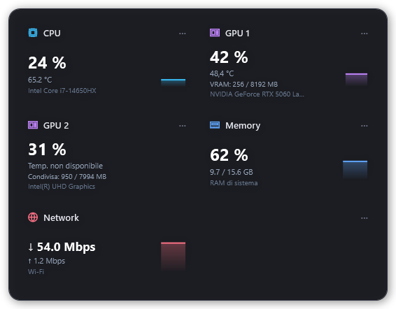
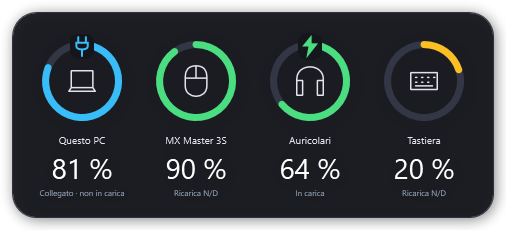

<p align="center"></p>

# OpenWidget

**Portable Windows desktop widgets for hardware monitoring and battery tracking.**
Watch CPU and GPU temperatures, processor load, RAM usage, network speed and the battery levels of your PC, Logitech mouse and Sony DualSense controller.

[](#requirements)
[](https://github.com/Kibra2025/OpenWidget/releases/latest)
[](https://github.com/Kibra2025/OpenWidget/actions/workflows/build.yml)
[](LICENSE)

**[Download for Windows x64](https://github.com/Kibra2025/OpenWidget/releases/latest)** · **[Guida in italiano 🇮🇹](docs/README.it.md)** · **[Report a bug](https://github.com/Kibra2025/OpenWidget/issues)**




*Previews use sample data. Available sensors and battery readings depend on your hardware.*

## Download and run

1. Open the [latest release](https://github.com/Kibra2025/OpenWidget/releases/latest) and download **`OpenWidget-Portable-1.7.0-win-x64.zip`** from **Assets**.
2. Extract the entire ZIP to a writable folder. Keep the DLLs, `tools` and `licenses` together with the application.
3. Run **`OpenWidget.exe`** or **`Avvia.bat`**, and accept the Windows administrator prompt.
4. Click the tray icon to open settings. The application interface is currently **Italian**.

No application installer is needed. GitHub's **Source code** archives are for developers; use the **Portable** ZIP to run the app. The release also includes a SHA-256 checksum file.

## What it monitors

| Widget | Readings and controls |
| --- | --- |
| CPU | Load, temperature when supported, and a history graph |
| GPUs | A separate card for each detected NVIDIA, AMD or Intel GPU, with available load, temperature and memory readings |
| RAM | Used and total system memory |
| Network | Download and upload speed, with automatic graph scaling |
| PC battery | Charge level, charging status and system-reported remaining time |
| Accessories | Battery information exposed by Windows and compatible Bluetooth / USB devices |
| Logitech HID++ | Battery and charging state through supported Bluetooth, Logi Bolt and Unifying interfaces, including compatible MX Master devices |
| DualSense / DualSense Edge | Battery and charging state over USB and Bluetooth; individual controllers are shown separately |

Both widgets have independent positioning, locking and click-through controls. Hide individual GPU cards, switch to compact mode, adjust refresh intervals and optionally start with Windows. The widgets stay behind ordinary application windows.

Missing or unsupported readings appear as unavailable. DualSense battery levels are approximate, in roughly 10% steps. Windows does not expose battery information for every accessory, phone, watch or headset.

## Requirements

- **Windows 10 or Windows 11, x64**. ARM64 and 32-bit packages are not provided.
- **.NET Framework 4.8**. A modern .NET runtime or SDK is not required to run the application.
- **Administrator privileges**: requested by the executable manifest.
- **PawnIO 2.2 or later** for low-level CPU temperature access. Use **Abilita temperature CPU (installa PawnIO)** in the menu to launch the bundled official installer. This installs a system driver once per PC; it is optional for other available readings.

Drivers are never installed automatically. Sensor support also depends on your processor, graphics hardware and drivers. Some integrated GPUs expose no temperature sensor.

## Settings and startup

Click the tray icon, or right-click a widget and choose **Gestisci widget e impostazioni…**. Settings include hardware-card visibility, battery filters, position, click-through, refresh rate, Windows startup and diagnostics. Use **Applica** to save.

Configuration and logs are stored beside the executable when writable, otherwise under `%LOCALAPPDATA%\DeskHardwareWidget`. The old data-directory and scheduled-task identifiers are retained so existing users keep their settings. Release packages contain no personal configuration or logs.

**Avvia con Windows come amministratore** creates a scheduled task for the current administrator user. Startup is disabled by default. If you move the application, launch it once from the new folder to refresh the task path. Disable startup from the same menu before removing the application.

## Build from source

Clone or download this repository on Windows, then run:

```powershell
powershell.exe -NoProfile -ExecutionPolicy Bypass -File .\build.ps1 -RunTests
powershell.exe -NoProfile -ExecutionPolicy Bypass -File .\publish.ps1 -SkipBuild
```

Or double-click `build.bat` and `publish.bat`. The scripts use the .NET Framework MSBuild and C# compiler included with Windows. On the first build, the script downloads pinned dependencies from official GitHub releases and Microsoft's .NET Framework 4.8 reference assemblies from NuGet. All bundled dependencies are verified against `dependencies.json` before compilation.

| Output | Location |
| --- | --- |
| Executable | `bin/Release/OpenWidget.exe` |
| Portable folder | `dist/OpenWidget-Portable/` |
| Downloadable ZIP | `dist/OpenWidget-Portable-1.7.0-win-x64.zip` |
| Regression checks and generated previews | `.build/tests/` |

The regression suite covers configuration recovery, startup definitions, hardware and battery parsing, multi-GPU cards, positioning, graphs, settings and real WPF windows. See [development and releases](docs/DEVELOPMENT.md) for the repository layout and release procedure.

For five diagnostic hardware samples, without opening the widget:

```powershell
.\bin\Release\OpenWidget.exe --diagnostics .\diagnostics.json 5
```

Diagnostics contain details about your hardware; review the file before attaching it to an issue.

## Contributing and support

Bug reports and pull requests are welcome. Include the OpenWidget version, Windows version, device model, connection type and steps to reproduce the problem. [Read the contribution guide](CONTRIBUTING.md).

## License and credits

OpenWidget's original code and assets are released under the [MIT License](LICENSE), Copyright © 2026 Brayan Kidarame.

Third-party components retain their own licenses. OpenWidget uses [LibreHardwareMonitor](https://github.com/LibreHardwareMonitor/LibreHardwareMonitor) for hardware readings, [HidSharp](https://software.seekye.com/hidsharp) for HID access, and an adapted MIT-licensed LogiCopy+ transport for Logitech HID++. DualSense protocol references are documented separately; the DualSenseClient application is not bundled. See [third-party notices and source locations](licenses/DEPENDENCIES.txt).

**Related topics:** Windows desktop widget, hardware monitor, CPU temperature monitor, GPU temperature monitor, RAM monitor, network speed monitor, battery widget, Bluetooth battery, Logitech HID++, MX Master, DualSense battery, WPF, C#, open source.
